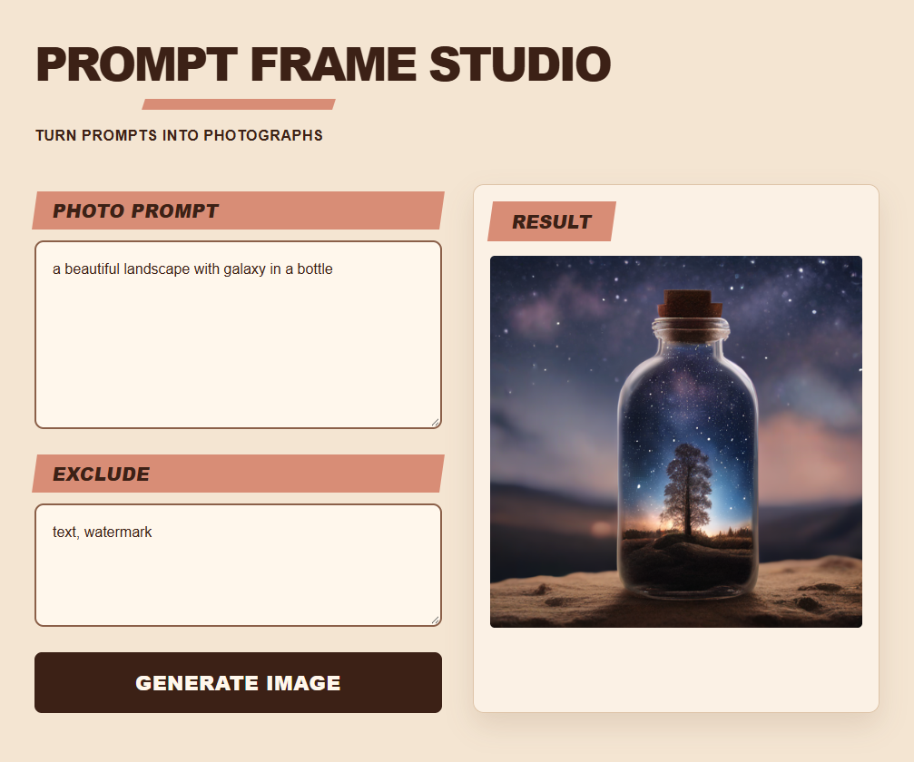

# PROMPT FRAME STUDIO

프롬프트 입력 기반 원격 ComfyUI 이미지 생성 Flask 웹 애플리케이션



## 프로젝트 개요

- 사진관 콘셉트 이미지 생성 웹 화면
- Flask 컨테이너와 ComfyUI 서버의 IP 연결
- Flux 2 워크플로 JSON의 ComfyUI API 전달
- 생성 이미지 주소의 화면 표시
- Photo Prompt와 Exclude 입력값의 워크플로 반영

## 사용 기술

- Python 3.12
- Flask
- Requests
- Docker / Docker Compose
- ComfyUI API
- Flux 2 워크플로
- HTML / CSS / JavaScript

## 동작 구조

```text
브라우저
   ↓
Flask 컨테이너 :5000
   ↓  /prompt, /history, /view
ComfyUI 서버 :8188
   ↓
생성 이미지
```

## 폴더 구조

```text
promptframe-studio/
├─ app.py
├─ requirements.txt
├─ Dockerfile
├─ docker-compose.yml
├─ static/
│  └─ flux2.json
├─ templates/
│  └─ image.html
├─ docs/
│  └─ 20261112-docker-flux2.md
└─ prompt-frame-studio.png
```

## 사전 준비

- Docker 설치
- ComfyUI 실행
- ComfyUI 서버 IP 주소 및 포트 확인
- Flux 2 워크플로 지정 모델 파일 설치

## 실행 방법

### 1. ComfyUI 주소 설정

기본 주소: `http://192.168.24.135:8188`

다른 주소 사용 시 환경 변수 지정

```bash
COMFY_URL=http://COMFYUI_IP:8188 docker compose up --build
```

Windows PowerShell 환경 변수 지정

```powershell
$env:COMFY_URL = "http://COMFYUI_IP:8188"
docker compose up --build
```

### 2. 컨테이너 실행

```bash
docker compose up --build
```

### 3. 웹 화면 접속

```text
http://localhost:5000
```

## 이미지 생성 과정

1. Photo Prompt와 Exclude 입력
2. `static/flux2.json` 로드
3. Flux 2 워크플로 프롬프트 및 시드 변경
4. ComfyUI `/prompt` API 호출
5. `/history/{prompt_id}` 기반 생성 상태 확인
6. ComfyUI 이미지 주소의 화면 표시

## Flux 2 워크플로 참고

- 워크플로 파일: `static/flux2.json`
- 양성 프롬프트 노드: `76`
- 음성 프롬프트 노드: `75:67`
- 랜덤 시드 노드: `75:73`
- 이미지 저장 노드: `9`
- 모델 파일명과 `UNETLoader`, `CLIPLoader`, `VAELoader` 설정의 일치

기존 테스트 워크플로 노드 `6`, `7`, `13`과 Flux 2 워크플로 노드 번호의 차이 확인

## 연결 확인

Flask 컨테이너에서 ComfyUI `/system_stats` 응답 확인

```bash
docker exec flaskserver python -c "import requests; print(requests.get('http://COMFYUI_IP:8188/system_stats').status_code)"
```

정상 응답 코드: `200`

## 문제 해결

- `Workflow not found`: 컨테이너 내부 `static/flux2.json` 경로 확인
- `Connection refused`: ComfyUI 실행 여부, IP 주소, 포트 `8188` 확인
- `POST / 500`: Flask 로그, 워크플로 노드 번호, JSON 구조 확인
- 이미지 미출력: Flux 2 모델 파일 및 ComfyUI 출력 경로 확인
- 브라우저 접속 불가: Flask 포트 `5000:5000` 매핑 확인

## 문서

- [Docker·VM·ComfyUI 연결 실습](docs/20261112-docker-flux2.md)

## 주의사항

- 모델 파일 저장소 미포함
- 생성 결과 이미지, 비밀번호, 접속 토큰 저장소 업로드 금지
- Flask 개발 서버의 실습 목적 사용
